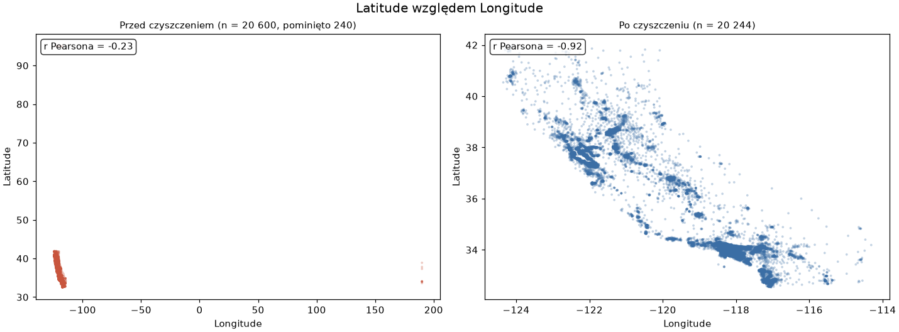
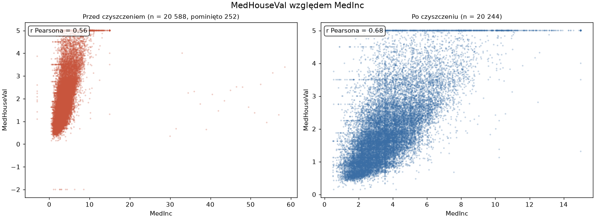

# Studio jakości i wizualizacji danych

Projekt 2 z Programowania V (laboratoria 6–9). Aplikacja prowadzi od wczytania pliku CSV przez diagnozę
i czyszczenie danych do wizualizacji i eksportu, a każda zmiana zbioru jest zapisana w raporcie.

**Stan: lab 6 i 7 gotowe.**
- Lab 6: profil danych, wykrywanie problemów, pipeline czyszczenia, raport przed/po, `cleaned.csv`.
- Lab 7: wykresy (histogram, punktowy, pudełkowy, słupkowy) z walidacją kolumn, wykresy przed/po, analiza korelacji.

Lab 8 (GUI Tkinter) i 9 (eksport, dokumentacja końcowa) w przygotowaniu.

## Wymagania i instalacja

Python 3.10+ (testowane na 3.14, pandas 3.1, numpy 2.5, matplotlib 3.11, seaborn 0.13).

```bash
python -m venv .venv
.venv\Scripts\activate          # Windows; Linux/macOS: source .venv/bin/activate
pip install -r requirements.txt
```

## Uruchomienie (lab 6)

```bash
python run_lab6.py                                  # zbiór referencyjny + config/california.json
python run_lab6.py dane.csv                         # dowolny CSV + config/domyslna.json
python run_lab6.py dane.csv --range wiek 0 120      # reguła zakresu: tylko oznacza rekordy
python run_lab6.py dane.csv --range wiek 0 - --range-action nan   # '-' = brak granicy; akcja nan/drop/clip
python run_lab6.py dane.csv --config moja.json --out wyniki
python run_lab6.py dane.csv --skip-bad-lines        # pomija wadliwe wiersze (ich liczba trafia do raportu)
```

Wyniki w `output/` (albo w katalogu z `--out`):

- `cleaned.csv`: dane po czyszczeniu (+ kolumny `*_outlier` / `*_poza_zakresem` z oznaczeniami),
- `raport_lab6.md`: raport przed/po (wykryte problemy, każda operacja z liczbą dotkniętych rekordów
  i uzasadnieniem, kontrola zmienionych kolumn, profil i statystyki przed/po, suma SHA-256 wyniku),
- `audit_log.json`: dziennik operacji (parametry, czas, rekordy przed/po, zmienione komórki).

### Dowolny plik CSV

- Separator (`,` `;` tabulator), przecinek dziesiętny i kodowanie (UTF-8 / Windows-1250) są wykrywane same.
- `config/domyslna.json` nie zawiera nazw kolumn, tylko grupy `"numeric"` i `"text"`, rozwijane
  dla każdego pliku osobno: braki liczbowe uzupełnia medianą, tekstowe najczęstszą wartością,
  wartości odstające (IQR) oznacza we wszystkich kolumnach liczbowych.
- Reguł zakresu nie da się zgadnąć bez wiedzy o danych, więc podaje się je opcją `--range` albo we własnej
  konfiguracji. Domyślna akcja `flag` niczego nie zmienia, tylko oznacza rekordy.
- Konfiguracja z nazwami kolumn, których nie ma w pliku, kończy się czytelnym błędem jeszcze przed czyszczeniem.

## Uruchomienie (lab 7)

```bash
python run_lab7.py                                   # zbiór referencyjny + config/wykresy_california.json
python run_lab7.py dane.csv                          # dowolny CSV: wykresy dobrane według typów kolumn
python run_lab7.py dane.csv --charts moje.json       # własny zestaw wykresów
python run_lab7.py --chart kind=scatter x=MedInc y=MedHouseVal compare=tak
python run_lab7.py dane.csv --chart kind=bar x=miasto --chart kind=histogram x=wiek bins=10
```

Skrypt najpierw czyści dane tak samo jak `run_lab6.py`, a potem rysuje wykresy. Wyniki:

- `output/wykresy/*.png`: wykresy; `*_przed_po.png` pokazują dane surowe i oczyszczone obok siebie,
- `output/raport_lab7.md`: wykresy z parametrami i wnioskami, analiza korelacji, lista wykresów
  zablokowanych przez walidację z powodem blokady.

### Wykres z parametrów

Wykres opisuje `ChartSpec` (`studio/charts.py`), a buduje go `build_figure(frame, spec)` albo
`build_comparison_figure(before, after, spec)`. Wynikiem jest `matplotlib.figure.Figure` (bez `pyplot`),
więc ten sam wykres da się zapisać do pliku i osadzić w oknie Tkinter.

| Parametr | Znaczenie |
|---|---|
| `kind` | `histogram`, `scatter`, `box`, `bar`, `correlation` |
| `x` | histogram / box: kolumna liczbowa; bar: kolumna z kategoriami; scatter: oś X |
| `y` | scatter: oś Y; bar: kolumna, której średnią pokazują słupki (bez `y`: liczba rekordów) |
| `by` | box: osobne pudełko dla każdej kategorii |
| `bins` | histogram: liczba słupków; bar / box: podział kolumny liczbowej `x` / `by` na przedziały |
| `log_scale` | skala logarytmiczna (wartości ≤ 0 są pomijane, ich liczba jest w tytule) |
| `method` | correlation: `pearson` albo `spearman` |
| `title` | własny tytuł (domyślny powstaje z parametrów) |

W pliku JSON z zestawem wykresów każdy wpis może mieć też `compare` (przed/po obok siebie) i `comment`
(wniosek do raportu), a cały plik `correlation_top` i `correlation_comment`.

### Walidacja kolumn

Zanim cokolwiek zostanie narysowane, kolumny są sprawdzane. Błąd (`ChartError`) mówi, co jest nie tak
i co wybrać zamiast, np.:

- `Kolumna 'kategoria' jest tekstowa, a wykres punktowy wymaga kolumny liczbowej. Kolumny liczbowe: cena, ilosc.`
- `Kolumna 'stala' jest stała (każda wartość = 1), więc histogram niczego nie pokaże. Wybierz inną kolumnę: ...`
- `Kolumna 'opis' ma 300 kategorii, a wykres jest czytelny do 20. Wybierz kolumnę z mniejszą liczbą kategorii: ...`
- `Kolumna liczbowa 'x' ma 30 różnych wartości. Podaj liczbę przedziałów (bins), np. 5, albo wybierz kolumnę z kategoriami.`

Sprawdzane są też: brak kolumny w danych, kolumny prawda/fałsz na osi wartości, puste kolumny, te same
kolumny na osiach X i Y, skala logarytmiczna bez wartości dodatnich i niepoprawne parametry (`bins` < 2,
nieznany rodzaj wykresu lub metoda). Dane surowe z tekstami w kolumnach liczbowych (np. `?`) da się narysować:
teksty są pomijane, a ich liczba trafia do tytułu wykresu.

## Struktura

```
studio/                 logika (bez GUI)
  loader.py             wczytywanie CSV: kodowanie, separator, przecinek dziesiętny, błędy
  profiling.py          profil (rozmiar, typy, statystyki, braki i %, duplikaty, unikalność) + diagnoza
  rules.py              reguły zakresu (RangeRule) i metoda IQR, tylko wykrywanie
  cleaning.py           operacje czyszczenia: dostają DataFrame, zwracają nową kopię + opis zmian
  session.py            DataSession: dane surowe / bieżące, dziennik operacji, reset
  pipeline.py           kroki czyszczenia z pliku JSON
  report.py             raport Markdown przed/po
  charts.py             wykresy: ChartSpec, walidacja kolumn, build_figure / build_comparison_figure
  correlation.py        macierz korelacji, najsilniejsze pary, opis słowny bez sugerowania przyczyny
  chart_set.py          zestaw wykresów z JSON albo dobrany automatycznie dla dowolnego CSV
  chart_report.py       raport Markdown z wykresami i analizą korelacji
config/california.json  reguły i decyzje dla zbioru referencyjnego
config/domyslna.json    konfiguracja dla dowolnego CSV
config/wykresy_california.json  wykresy i wnioski dla zbioru referencyjnego
run_lab6.py             skrypt lab 6
run_lab7.py             skrypt lab 7
tests/                  testy pytest (opis danych testowych: tests/data/OPIS.md)
```

Założenia: operacje nie zmieniają wejściowego DataFrame, więc dane surowe w sesji zostają nietknięte,
a operacja zakończona błędem nie zmienia danych. `DataSession.reset()` wraca do danych surowych bez ponownego
wczytywania pliku. Brak zmiennych globalnych. Ta sama sesja posłuży jako model dla GUI w lab 8.

## Pipeline dla zbioru California Housing

Wykryte w danych surowych (20 840 rekordów, 9 kolumn):

| Problem | Ile |
|---|---|
| pełne duplikaty | 200 |
| puste komórki (NaN) | 120 w każdej kolumnie |
| tekstowe oznaczenia braku (`?`, `--`, `brak`, `nieznane`, `error`, `do sprawdzenia`) | 24 (MedInc, HouseAge, Population, MedHouseVal) |
| wartości spoza zakresu | 110 (ujemne, Latitude = 95, Longitude = 190, MedInc > 15.0001) |
| wartości odstające IQR x 1,5 | 4 639 w 5 kolumnach (w tym ekstremalne: AveRooms do 553, AveOccup do 4849) |

Kroki i decyzje (pełne uzasadnienia w `config/california.json` i w raporcie):

1. **Duplikaty**: usunięcie pełnych duplikatów (identyczne wszystkie kolumny), zostaje pierwszy.
2. **Tekstowe braki**: zamiana na NaN; kolumny stają się liczbowe.
3. **Reguły zakresu**: wykrycie jest oddzielone od akcji. Wybrana akcja `nan`: wartość niemożliwa to brak
   informacji. Dostępne też `flag`, `drop`, `clip`.
4. **Braki, strategia 1: usunięcie** rekordów bez `MedHouseVal` (zmienna objaśniana) lub bez współrzędnych.
5. **Braki, strategia 2: imputacja medianą** pozostałych kolumn (rozkłady prawoskośne, mediana jest odporna
   na wartości odstające). Dostępne też `mean`, `mode`, `constant`.
6. **Wartości odstające**: tylko oznaczenie (`<kolumna>_outlier`), bez usuwania, bo wysokie średnie pokoi czy
   mieszkańców bywają prawdziwe (ośrodki wypoczynkowe, akademiki). Dostępne też `report`, `clip`, `drop`.

Wynik: 20 244 rekordy, 0 duplikatów, 0 braków, 0 naruszeń reguł. Każda kolumna jest zmieniana tylko przez
operacje, które jej dotyczą (tabela w sekcji 4 raportu). Wynik jest powtarzalny: bez losowości, ta sama suma
SHA-256 przy każdym uruchomieniu.

## Wykresy i korelacja dla zbioru California Housing

Pełny zestaw (14 wykresów z wnioskami) jest w `output/raport_lab7.md`. Najważniejsze obserwacje:



- Kilka niemożliwych współrzędnych (Longitude = 190, Latitude = 95) spłaszcza wykres danych surowych. Po czyszczeniu
  punkty układają się w kształt Kalifornii, a korelacja współrzędnych zmienia się z -0,23 na -0,92. Ta korelacja
  opisuje ukośny kształt stanu, a nie zależność jednej współrzędnej od drugiej.



- Po usunięciu niemożliwych wartości korelacja dochodu z wartością domów rośnie z 0,56 do 0,68 (silna, dodatnia).
  Pozioma linia na 5 to obcięcie wartości w oryginalnym zbiorze.
- Wartości odstające nie zawsze są błędem: dzielnice oznaczone jako odstające pod względem dochodu (682) mają średnio
  ponad dwa razy droższe domy niż pozostałe, więc zostają w danych (tylko oznaczone).
- Grupa wstrzykniętych obserwacji z 300–550 pokojami na gospodarstwo obniża korelację AveRooms–AveBedrms do 0,15,
  choć główna chmura punktów rośnie razem: kilkanaście rekordów potrafi ukryć zależność widoczną w większości danych.

**Korelacja to nie przyczynowość.** To, że w dzielnicach o wyższym dochodzie domy są zwykle droższe, nie znaczy, że
dochód podnosi ceny. Oba mogą wynikać z położenia (np. bliskości wybrzeża), a zamożne osoby mogą wybierać droższe
dzielnice. Opisy generowane przez program mówią tylko o współwystępowaniu („rekordy z wyższym X mają zwykle wyższe Y”).

## Testy

```bash
python -m pytest
```

Pokrywają macierz testów z instrukcji (część logiki): CSV z przecinkiem i średnikiem (też cp1250 i przecinek
dziesiętny), wadliwy wiersz, złe kodowanie, pusty plik; braki liczbowe i tekstowe z liczbą zmian; duplikaty
na kontrolowanej parze rekordów; reguła zakresu wykrywa bez zmiany danych; IQR na kolumnie stałej; reset sesji;
operacja z błędem nie zmienia danych; powtarzalność; ponowny odczyt zapisanego CSV; cały skrypt na kilku
różnych plikach CSV i z regułą z linii poleceń.

Wykresy (`tests/test_charts.py`): każdy z czterech typów ma tytuł i opisy osi; kolumna tekstowa, stała,
prawda/fałsz, nieistniejąca albo z za dużą liczbą kategorii jest blokowana z komunikatem; niepoprawne parametry
wykresu; wykres nie zmienia danych; porównanie przed/po; zapis do PNG, SVG i PDF; macierz korelacji tylko z kolumn
liczbowych, niestałych i bez identyfikatorów; Spearman odporny na wartość odstającą; opis korelacji bez słów
o przyczynie; skrypt lab 7 na trzech plikach CSV i z wykresem zablokowanym przez walidację.

## Znane ograniczenia

- Separator jest wykrywany z wiersza nagłówka (najczęstszy z `,` `;` tabulator).
- Kodowanie: UTF-8, a gdy się nie da, Windows-1250; inne trzeba podać jawnie (`load_csv(..., encoding=...)`).
- Granice IQR są liczone na bieżących danych, więc zależą od wcześniejszych kroków (kolejność jest w konfiguracji).
- Daty zostają tekstem (nie są rozpoznawane jako typ daty).
- Kolumny z numerem rekordu są rozpoznawane tylko po nazwie (`id`, `lp`, `nr`, `index`, `*_id`, `id_*`) i pomijane
  w automatycznym zestawie wykresów i w korelacji; jawnie wybrany wykres z taką kolumną da się narysować.
- Domyślna liczba słupków histogramu to pierwiastek z liczby wartości w granicach 10–60 (reguły automatyczne
  numpy przy długim ogonie dawały dziesiątki tysięcy słupków).
- Na wykresie punktowym punkty są w PDF/SVG zapisane jako obraz (`rasterized`), żeby plik nie miał 20 tysięcy obiektów.

## Źródła, biblioteki i narzędzia AI

- pandas (`read_csv`, braki danych, duplikaty): https://pandas.pydata.org/docs/
- Opis zbioru California Housing (obcięcia MedInc 15.0001, HouseAge 52, MedHouseVal 5.00001):
  https://scikit-learn.org/stable/datasets/real_world.html#california-housing-dataset
- matplotlib (`Figure` bez `pyplot`, `boxplot`, `scatter`, `bar`): https://matplotlib.org/stable/
- seaborn (`histplot`, `heatmap`): https://seaborn.pydata.org/tutorial.html
- `DataFrame.corr` (Pearson, Spearman): https://pandas.pydata.org/docs/reference/api/pandas.DataFrame.corr.html
- Wzorzec `DataSession` i `histogram_figure` zwracającej `Figure` z instrukcji projektu (kod inspiracyjny).
- Narzędzie AI: Claude (Anthropic), pomoc przy projekcie struktury, kodzie i testach; kod został przejrzany
  i jest rozumiany przez autora.
