# Raport wykresów (lab 7)

- Źródło: `california_housing_projekt2.csv`
- Rekordy: 20840 przed czyszczeniem, 20244 po czyszczeniu
- Wykresy: 14 narysowanych, 0 zablokowanych przez walidację
- Wygenerowano: 2026-11-23T17:53:14

## Jak czytać wykresy

- *Przed czyszczeniem* to dane surowe z pliku. Teksty w kolumnach liczbowych (np. `?`, `brak`) i puste komórki nie dają się narysować, więc są pominięte; ich liczba jest w tytule wykresu (`pominięto`).
- *Po czyszczeniu* to dane z `cleaned.csv`.
- Wykres pudełkowy: pudełko = kwartyle Q1–Q3, kreska = mediana, wąsy sięgają do 1,5 × IQR, a punkty poza wąsami to wartości odstające według tej samej reguły, którą wykrywa pipeline.
- Skala logarytmiczna (tam, gdzie zaznaczono) pokazuje tylko wartości dodatnie.

## 1. Braki danych przed i po czyszczeniu

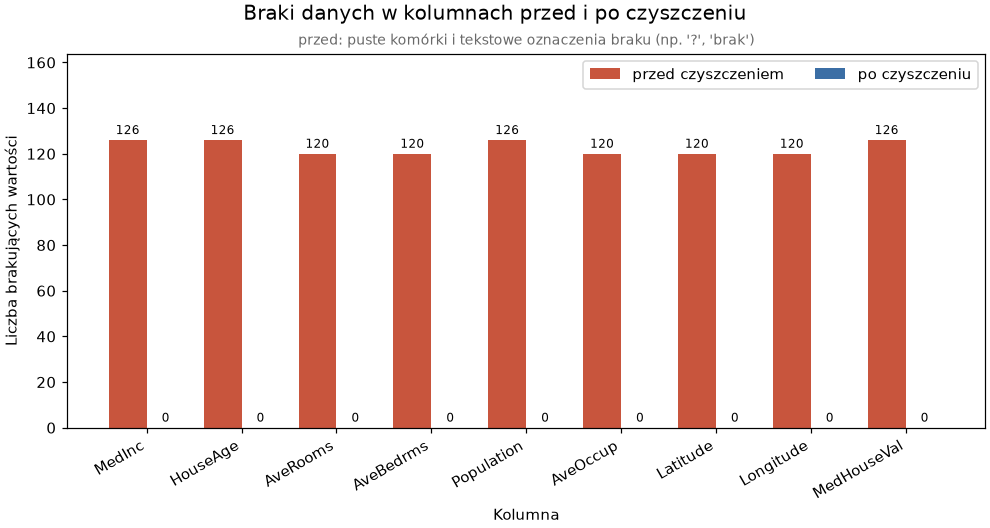

## 2. Wykresy

### 1. Rozkład wartości: MedHouseVal (przed i po)

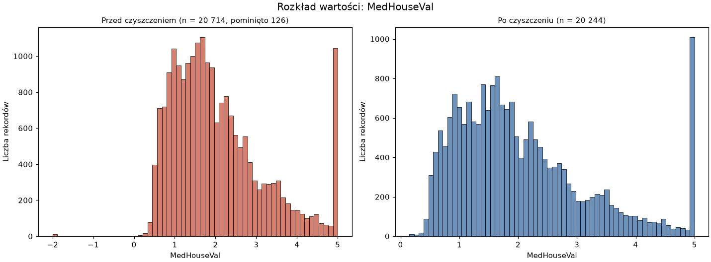

*Parametry:* histogram; x = `MedHouseVal`.

**Wniosek:** Przed czyszczeniem oś zaczyna się od -2 (niemożliwe ujemne wartości domów). Po czyszczeniu rozkład jest prawoskośny z pikiem przy 5.00001: to górne obcięcie wartości w oryginalnym zbiorze (976 dzielnic), a nie błąd, więc te rekordy zostają.

### 2. Rozkład wartości: MedInc (przed i po)

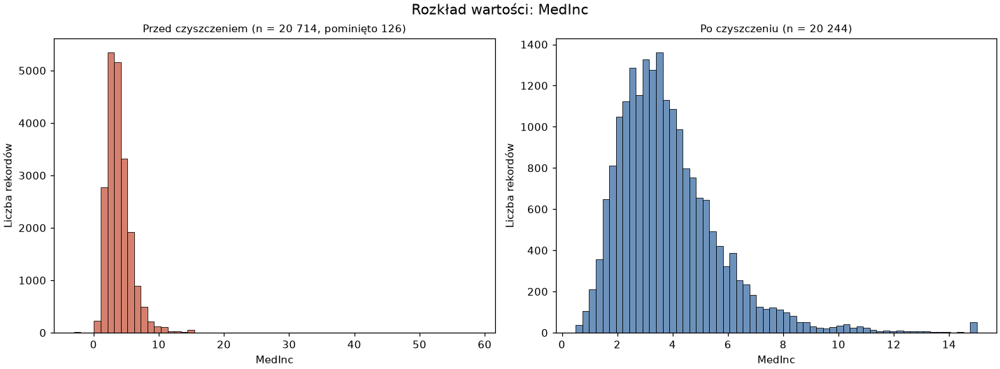

*Parametry:* histogram; x = `MedInc`.

**Wniosek:** Wstrzyknięte wartości do 58.5 rozciągają oś danych surowych tak, że cały rozkład mieści się w kilku słupkach. Po regule zakresu (0 < MedInc ≤ 15.0001) widać właściwy, prawoskośny rozkład dochodu z małym pikiem przy obcięciu 15.0001.

### 3. Rozkład wartości: HouseAge (przed i po)

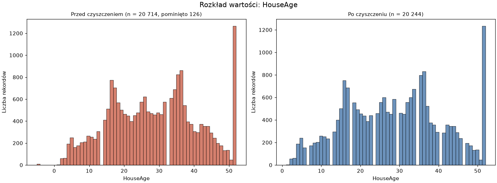

*Parametry:* histogram; x = `HouseAge`.

**Wniosek:** Pik przy 52 latach to górne obcięcie wieku w oryginalnym zbiorze (1233 dzielnice). Czyszczenie usuwa ujemny wiek, kształt rozkładu się nie zmienia.

### 4. Rozkład wartości: AveOccup (przed i po)

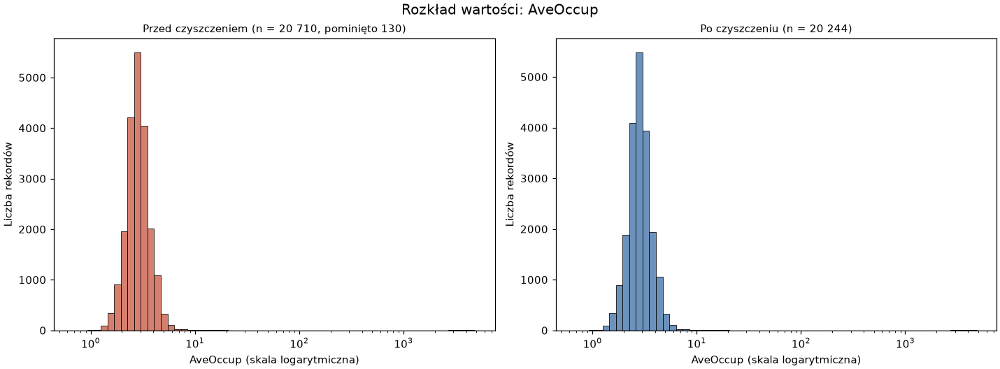

*Parametry:* histogram; x = `AveOccup`; skala logarytmiczna.

**Wniosek:** Skala logarytmiczna, bo pojedyncze dzielnice mają średnio tysiące mieszkańców na gospodarstwo (do 4849). Takie wartości są tylko oznaczone w AveOccup_outlier, nie usunięte: mogą to być akademiki, koszary albo zakłady, a nie błąd zapisu.

### 5. Rozkład i wartości odstające: MedInc (przed i po)

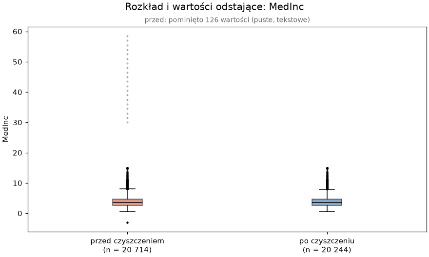

*Parametry:* wykres pudełkowy; x = `MedInc`.

**Wniosek:** W danych surowych wąsy i pudełko są ściśnięte przez wartości do 58.5; po czyszczeniu punkty powyżej górnego wąsa to dzielnice o wysokim dochodzie (682 oznaczone jako MedInc_outlier). Zostają w danych, bo to prawdziwe, bogate dzielnice.

### 6. Rozkład i wartości odstające: AveRooms (przed i po)

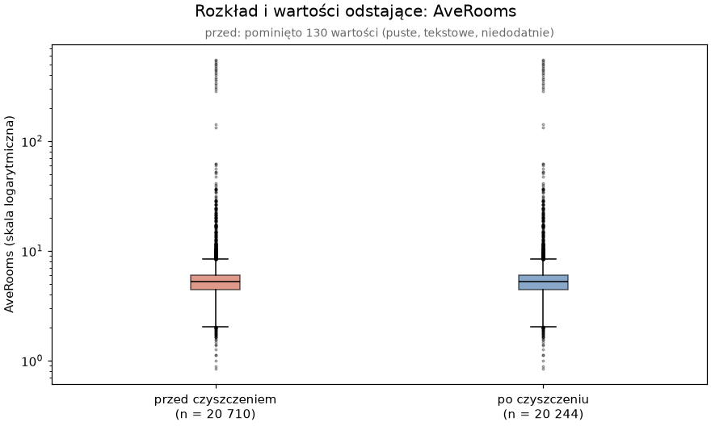

*Parametry:* wykres pudełkowy; x = `AveRooms`; skala logarytmiczna.

**Wniosek:** Wartości odstające są po obu stronach. Grupa 300-550 pokoi na gospodarstwo to wstrzyknięte, ekstremalne obserwacje; zostały oznaczone (AveRooms_outlier), a nie usunięte, żeby decyzję o nich podjąć jawnie przy analizie, a nie po cichu.

### 7. Rozkład MedHouseVal w grupach HouseAge

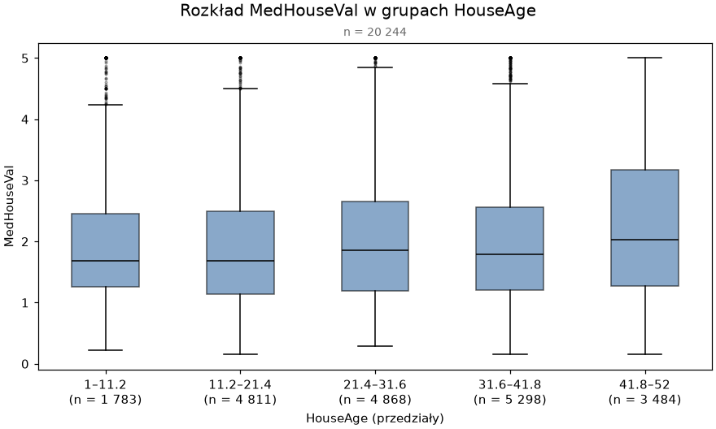

*Parametry:* wykres pudełkowy; x = `MedHouseVal`; grupy wg `HouseAge`; przedziały: 5.

**Wniosek:** Mediany wartości domów w grupach wieku zabudowy są podobne (ok. 1.7-2.0); najstarsza grupa ma największy rozrzut. Wiek zabudowy sam w sobie słabo różnicuje wartość domów.

### 8. MedHouseVal względem MedInc (przed i po)

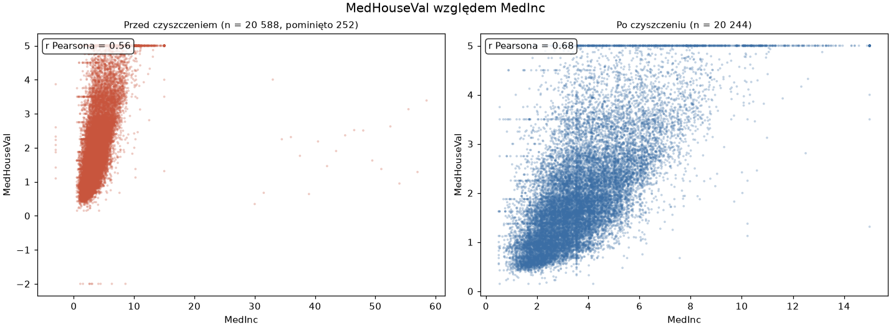

*Parametry:* wykres punktowy; x = `MedInc`; y = `MedHouseVal`.

**Wniosek:** Po czyszczeniu widać wyraźną dodatnią zależność (r z 0.56 na 0.68), bo zniknęły ujemne wartości i dochody do 58.5, które nie pasowały do reszty. Pozioma linia na 5 to obcięcie MedHouseVal: dla najbogatszych dzielnic prawdziwa wartość jest wyższa, niż pokazują dane.

### 9. Latitude względem Longitude (przed i po)

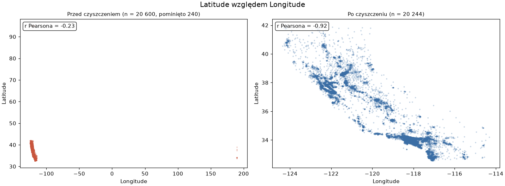

*Parametry:* wykres punktowy; x = `Longitude`; y = `Latitude`.

**Wniosek:** Przed czyszczeniem kilka rekordów z Longitude = 190 i Latitude = 95 (poza zakresem współrzędnych) spłaszcza wykres. Po czyszczeniu punkty układają się w kształt Kalifornii, a silna ujemna korelacja (-0.92) wynika z ukośnego kształtu stanu, a nie z zależności jednej współrzędnej od drugiej.

### 10. AveBedrms względem AveRooms

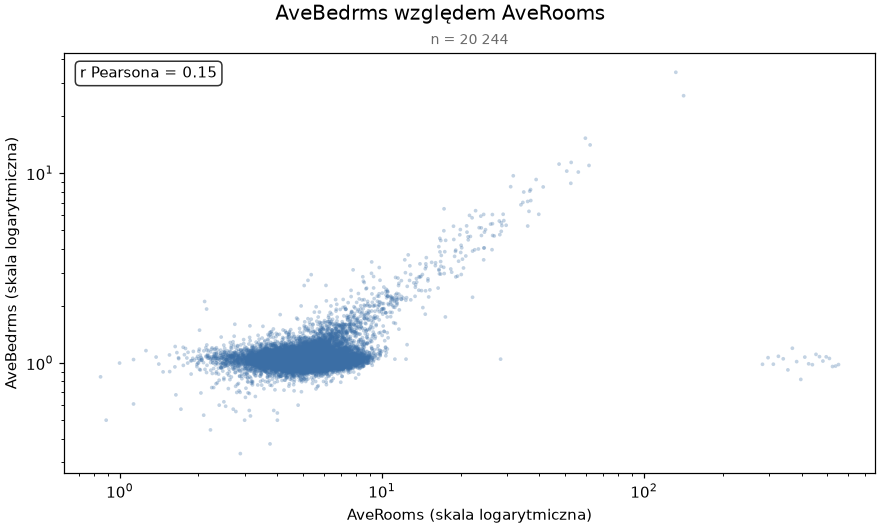

*Parametry:* wykres punktowy; x = `AveRooms`; y = `AveBedrms`; skala logarytmiczna.

**Wniosek:** Główna chmura punktów rośnie razem (więcej pokoi, więcej sypialni), ale grupa ~300-550 pokoi przy ok. 1 sypialni (wstrzyknięte outliery) zaniża r Pearsona do 0.15. Pokazuje to, jak kilkanaście obserwacji potrafi ukryć zależność widoczną w większości danych.

### 11. Średnia MedHouseVal w grupach MedInc

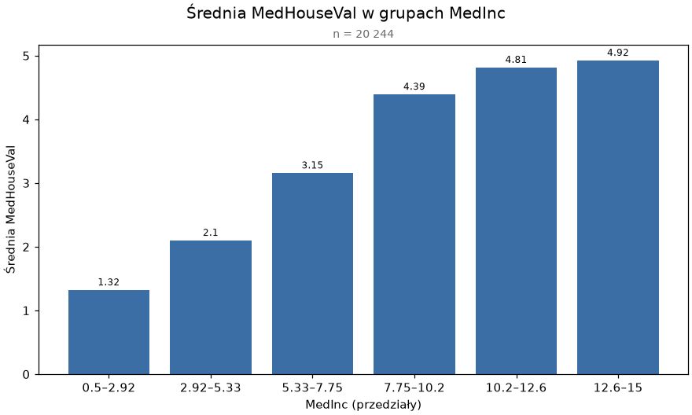

*Parametry:* wykres słupkowy; x = `MedInc`; y = `MedHouseVal`; przedziały: 6.

**Wniosek:** Średnia wartość domów rośnie w każdym kolejnym przedziale dochodu, a dla najwyższych przedziałów zbliża się do obcięcia 5. To współwystępowanie, a nie dowód, że dochód podnosi ceny: oba mogą zależeć np. od położenia dzielnicy.

### 12. Średnia MedHouseVal w grupach MedInc_outlier

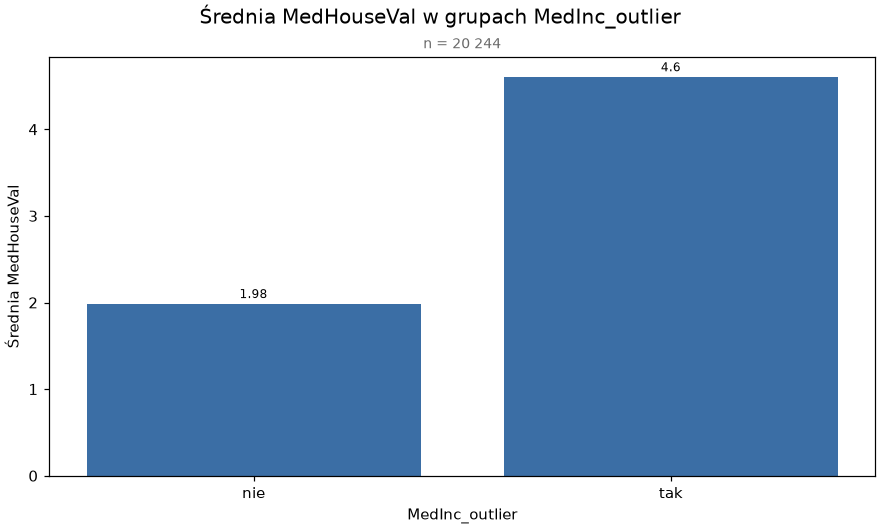

*Parametry:* wykres słupkowy; x = `MedInc_outlier`; y = `MedHouseVal`.

**Wniosek:** Dzielnice oznaczone jako odstające pod względem dochodu (682) mają średnio ponad dwa razy wyższą wartość domów niż pozostałe. To argument, żeby ich nie usuwać: są nietypowe, ale spójne z resztą danych.

### 13. Korelacja Pearsona (zależność liniowa) (przed i po)

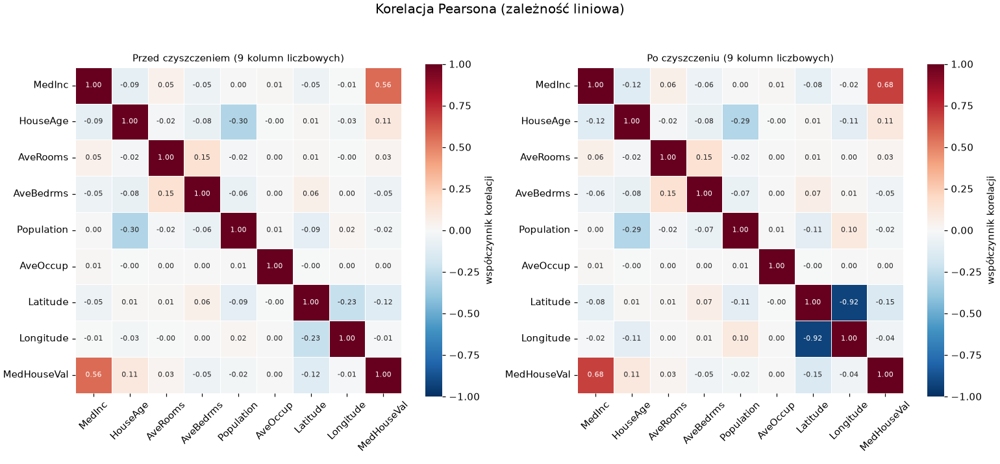

*Parametry:* mapa korelacji; metoda Pearsona (zależność liniowa).

**Wniosek:** Czyszczenie zmienia przede wszystkim korelację współrzędnych (z -0.23 na -0.92) i dochodu z wartością domów (z 0.56 na 0.68). Pozostałe pary zmieniają się niewiele.

### 14. Korelacja Spearmana (zależność monotoniczna, odporna na wartości odstające)

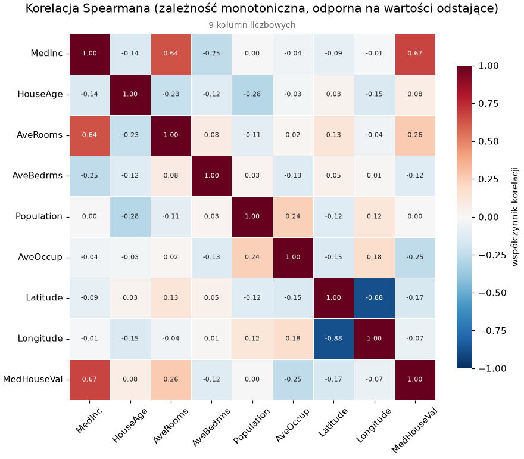

*Parametry:* mapa korelacji; metoda Spearmana (zależność monotoniczna, odporna na wartości odstające).

**Wniosek:** Spearman daje podobny obraz jak Pearson. Wyjątek to AveRooms - AveBedrms: oba współczynniki są niskie, choć na wykresie punktowym główna chmura rośnie razem.

## 3. Korelacja

Współczynnik Pearsona mierzy zależność liniową, Spearmana zależność monotoniczną (liczony na rangach, więc mniej czuły na wartości odstające). Wartości od -1 do 1; 0 = brak takiej zależności. Siła wg umownej skali |r|: ≥ 0,8 bardzo silna, ≥ 0,6 silna, ≥ 0,4 umiarkowana, ≥ 0,2 słaba.

**Najsilniej skorelowane pary po czyszczeniu (top 6):**

| Para kolumn | Pearson (po) | Spearman (po) | Siła (Pearson) | Pearson (przed) |
| --- | --- | --- | --- | --- |
| Latitude – Longitude | -0.92 | -0.88 | bardzo silna | -0.23 |
| MedInc – MedHouseVal | 0.68 | 0.67 | silna | 0.56 |
| HouseAge – Population | -0.29 | -0.28 | słaba | -0.30 |
| AveRooms – AveBedrms | 0.15 | 0.08 | bardzo słaba lub brak | 0.15 |
| Latitude – MedHouseVal | -0.15 | -0.17 | bardzo słaba lub brak | -0.12 |
| MedInc – HouseAge | -0.12 | -0.14 | bardzo słaba lub brak | -0.09 |

**Jak czyszczenie zmieniło korelację** (największe zmiany współczynnika Pearsona):

| Para kolumn | Pearson przed | Pearson po | Zmiana |
| --- | --- | --- | --- |
| Latitude – Longitude | -0.23 | -0.92 | -0.70 |
| MedInc – MedHouseVal | 0.56 | 0.68 | +0.12 |
| HouseAge – Longitude | -0.03 | -0.11 | -0.08 |
| Population – Longitude | 0.02 | 0.10 | +0.08 |
| Longitude – MedHouseVal | -0.01 | -0.04 | -0.03 |
| MedInc – HouseAge | -0.09 | -0.12 | -0.03 |

**Opis zależności (wygenerowany):**

- Latitude i Longitude: r = -0.92, zależność bardzo silna ujemna; rekordy z wyższym Latitude mają zwykle niższe Longitude.
- MedInc i MedHouseVal: r = 0.68, zależność silna dodatnia; rekordy z wyższym MedInc mają zwykle także wyższe MedHouseVal.
- HouseAge i Population: r = -0.29, zależność słaba ujemna; rekordy z wyższym HouseAge mają zwykle niższe Population.
- AveRooms i AveBedrms: r = 0.15, zależność bardzo słaba lub brak; wartości tych kolumn praktycznie nie zmieniają się razem.
- Latitude i MedHouseVal: r = -0.15, zależność bardzo słaba lub brak; wartości tych kolumn praktycznie nie zmieniają się razem.
- MedInc i HouseAge: r = -0.12, zależność bardzo słaba lub brak; wartości tych kolumn praktycznie nie zmieniają się razem.

**Interpretacja:** Najsilniejsza zależność (Latitude - Longitude) opisuje kształt stanu, a nie zjawisko w danych. Spośród zmiennych merytorycznych MedHouseVal najsilniej współwystępuje z MedInc (r = 0.68): w dzielnicach o wyższym dochodzie domy są zwykle droższe. Nie wynika z tego, że wyższy dochód powoduje wyższe ceny (zamożne osoby mogą wybierać droższe dzielnice albo oba wynikają z położenia, np. bliskości wybrzeża). Słaba ujemna korelacja HouseAge - Population (-0.29) też nie mówi o przyczynie: nowsze osiedla są po prostu często większe.

> **Korelacja to nie przyczynowość.** Korelacja opisuje współzmienność, a nie przyczynę. Silna korelacja dwóch kolumn nie oznacza, że jedna wpływa na drugą: obie mogą zależeć od trzeciego czynnika (np. położenia dzielnicy), a związek może też wynikać z definicji kolumn albo ze sposobu zebrania danych. Żeby mówić o przyczynie, potrzebny jest eksperyment albo model uwzględniający inne czynniki.

## 4. Wykresy zablokowane przez walidację

Wszystkie zaplanowane wykresy przeszły walidację kolumn.
